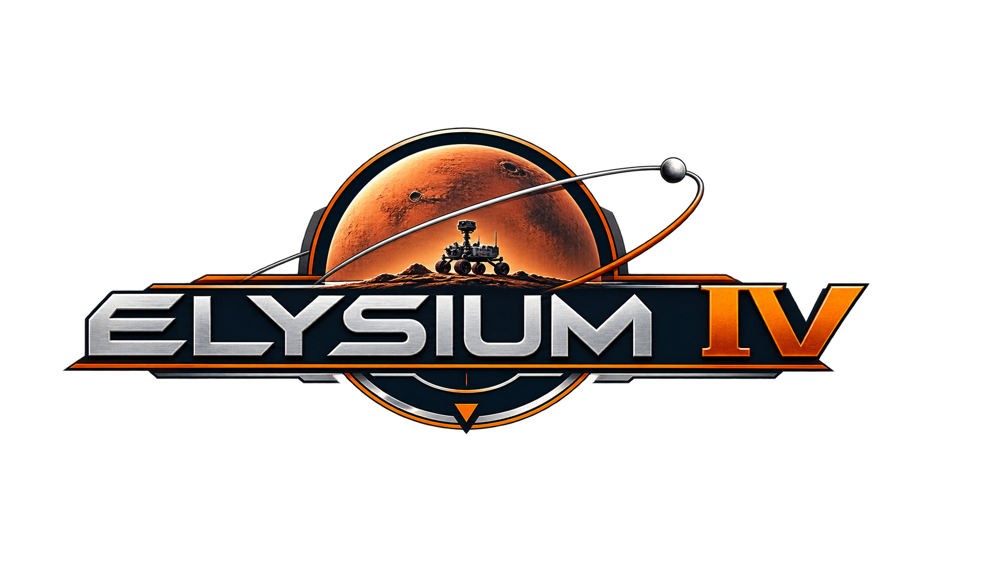

<div align="center">
  

  # ELYSIUM IV

  **Interactive Mars rover exploration across three Sols**

  Explore the Martian surface, operate a terrain rover, complete scientific investigations, and compile the expedition record.
</div>

---

## Contents

- [Overview](#overview)
- [The expedition](#the-expedition)
- [How to play](#how-to-play)
- [Starting, continuing, and replaying](#starting-continuing-and-replaying)
- [Requirements and setup](#requirements-and-setup)
- [Commands](#commands)
- [Project structure](#project-structure)
- [Mission data and progression](#mission-data-and-progression)
- [Saving and browser data](#saving-and-browser-data)
- [Assets and loading](#assets-and-loading)
- [Development notes](#development-notes)
- [Troubleshooting](#troubleshooting)
- [Credits, licensing, and asset use](#credits-licensing-and-asset-use)

## Overview

ELYSIUM IV is a first-person, browser-based 3D Mars exploration game. Its playable campaign follows a connected three-Sol expedition. Players move through rover interiors and outdoor terrain, use the rover to travel between mission locations, and interact with mission systems through the in-game Mission OS.

Mission objectives guide the experience. These include reviewing prior mission records, inspecting environmental and life-support systems, checking scientific equipment, collecting and analyzing a soil sample, photographing a mountain range, saving research logs, and compiling a final mission report.

The main experience is served by Next.js at `/play`. Visiting `/` redirects to `/play`. The app prepares its required 3D, environment, image, and audio assets before showing the menu.

## The expedition

### SOL 01 — Initial Surface Assessment

Begin at the first surface site and enter the terrain rover. Use the rover computer to initialize the mission, review environmental conditions, verify available tools and supplies, and save the required mission records. Drive to the observation checkpoint, inspect the updated conditions, and proceed to the SOL 01 finishing point.

SOL 01 establishes the first mission record used by the following Sols.

### SOL 02 — Daytime Soil Investigation

Review the SOL 01 records in the Mission OS, then inspect the BOTAN nutrition system, daytime environmental conditions, and scientific tools. Drive to the soil investigation checkpoint, park, exit in the EVA suit, and collect and document a soil sample. Return to the rover, transfer the sample to the designated rack, and review the analysis and images in the Mission OS. Drive to the SOL 02 finishing point and confirm mission completion.

### SOL 03 — Mountain Range Observation

Review the SOL 01 and SOL 02 records. Inspect the remaining water and nutrition supplies, environmental and oxygen systems, and mission tools. Drive to the SOL 03 checkpoint, exit the rover, and use the EVA camera to capture and save at least four mountain range photographs. Return to the rover, review the photographs, and save a mountain research log. Drive to the finishing point, complete the final mission report and verification tasks, then return to Mission Control.

When the required tasks are complete, select **Complete Journey** in the Mission OS. Confirming this action displays the final ELYSIUM IV completion page.

## How to play

Follow the current objective and the in-game prompts. The mission sequence depends on completing required inspections, records, samples, and navigation steps. Mission OS interactions generally happen at the rover's main computer; approach the relevant console or object and use the interaction prompt.

### Basic controls

| Action | Keyboard / mouse | Touchscreen |
| --- | --- | --- |
| Walk | `W` `A` `S` `D` | Movement stick |
| Look | Move the mouse after clicking the game view | Drag in the look area |
| Interact with a nearby object | `E` (some rover entry or exit interactions also accept `R`) | Context action button |
| Jog | Hold `Shift` | Sprint button |
| Jump | `Space` | Jump button |
| Release pointer lock | `Esc` | Not needed |

### Rover driving

When seated at the rover driving controls, use `W` and `S` to accelerate and reverse, and `A` and `D` to steer. `Space` brakes. Stop the rover before leaving driving mode; `E` or `R` exits driving mode when the rover is nearly stationary. `L` cycles the exterior rover lighting.

Navigation beams and destination markers indicate the active mission destination. The rover's active destination changes as mission objectives progress.

### EVA camera in SOL 03

At the SOL 03 checkpoint, use the EVA camera interface to frame and capture mountain photographs. A preview capture is not counted until it is saved. Save at least four photographs to complete the required photo count. The camera permits up to six photos; use the on-screen controls to save or delete a selected photo, and press `Backspace` to exit the camera. After exiting, review saved photos in the Mission OS gallery.

### Touch controls

On-screen controls appear on supported touchscreen layouts. The movement stick controls movement or rover steering depending on the current mode; a separate touch area controls looking around while walking. Context-sensitive buttons appear when an interaction or mode action is available.

## Starting, continuing, and replaying

The launch menu offers these campaign options:

- **New exploration:** start at SOL 01 and reset the three-Sol campaign progress.
- **Continue:** resume the saved expedition when a valid save is available.
- **Select previous Sols:** replay an available completed Sol from its arrival point.
- **Delete Sols:** manage saved Sol progress from the menu.

A replay begins at the selected Sol's arrival point and is intended to let the player revisit that mission. Continue restores the saved mission position where available. Menu options that affect saved data should be selected carefully, especially **New exploration** and **Delete Sols**.

## Requirements and setup

### Requirements

- Node.js and npm
- A modern desktop or mobile browser with WebGL support
- Sufficient memory and graphics capacity for the bundled 3D terrain, rover, and environment assets

### Install dependencies

```bash
npm install
```

### Run the development server

```bash
npm run dev
```

Open the local URL reported by Next.js, usually `http://localhost:3000`.

### Create and run a production build

```bash
npm run build
npm start
```

### TypeScript check

```bash
npm run typecheck
```

## Commands

| Command | Purpose |
| --- | --- |
| `npm run dev` | Start the Next.js development server. |
| `npm run build` | Create a production build. |
| `npm start` | Serve the production build locally. Run after `npm run build`. |
| `npm run typecheck` | Run the TypeScript compiler without emitting files. |

## Project structure

```text
public/
  assets/
    exr/                 Environment maps used for scene lighting
    images/               Branding and interface images
    models/               Logo, rover, Mars, and SOL terrain models
    sounds/               Ambient and movement audio
    videos/               Video assets used by the experience
  draco/                  Draco decoder files for compressed GLB models
  site.webmanifest        Web app manifest

src/
  app/                    Next.js routes, metadata, and global styles
  components/
    game/                 Game viewport, Mission OS, and touch controls
    loading/              Asset loading and launch experience
    menu/                 Main menu and menu styling
  core/                   Game runtime, state, mission manager, movement,
                          asset preparation, navigation, and transitions
  jsons/
    Missions/             SOL 01, SOL 02, and SOL 03 mission definitions
    Instructions/         Mission and navigation instruction content
    Screens/              Rover screen configuration by Sol
  missions/
    SOL_01/                SOL 01 logic, screens, and interfaces
    SOL_02/                SOL 02 logic, screens, and interfaces
    SOL_03/                SOL 03 logic, screens, and interfaces
  systems/
    rover/                 Rover interior, vehicle, and lighting systems
    navigation/            Mission navigation helpers
    operating-system/      In-game operating-system trigger support
    investigation/         Investigation forms and catalog

scripts/                   Project scripts
 tests/                    Focused source-level regression checks
```

### Main implementation areas

- `src/core/Game.ts` coordinates the game runtime and connects mission, movement, rover, terrain, and interface systems.
- `src/core/MissionManager.ts` manages the shared mission progression state and objective flow.
- `src/core/AssetLoading.ts` loads and prepares required assets before gameplay begins.
- `src/components/game/GameViewport.tsx` connects the 3D game to the React interface and mission overlays.
- `src/components/menu/MainMenu.tsx` reads campaign saves and presents start, continue, replay, and save-management options.
- `src/missions/SOL_01`, `SOL_02`, and `SOL_03` contain mission-specific managers, screens, and UI.
- `src/jsons/Missions/sol-01.json`, `sol-02.json`, and `sol-03.json` describe mission tasks and supporting configuration.

## Mission data and progression

Mission JSON files hold much of the task sequence and configuration, including mission identifiers, named terrain locations, task descriptions, required interactions, mission dependencies, and persistence settings. Mission managers implement the runtime rules for recording progress and determining when tasks are complete. Interface components present the forms and confirmations used to complete those tasks.

SOL 02 depends on the SOL 01 record. SOL 03 reads the SOL 01 and SOL 02 records as historical, read-only mission data. The intended order is therefore SOL 01 → SOL 02 → SOL 03.

The campaign uses named objects in the GLB terrain and rover models as spawn locations, interaction triggers, checkpoints, and destinations. When changing a model, mission JSON, or a trigger, keep the relevant names and references aligned.

## Saving and browser data

The game saves campaign position and mission progress in browser storage. The main campaign save uses `elysium_iv_save_state`. The three mission managers also keep mission-specific records:

- `elysium_iv_sol_01_progress`
- `elysium_iv_sol_02_progress`
- `elysium_iv_sol_03_progress`

SOL 03 photographs use IndexedDB when available and have a localStorage fallback. Saved progress belongs to the current browser profile and origin. It is not automatically synchronized to another device. Clearing site data, using private browsing, changing the site origin, or switching browsers can make local saves unavailable.

## Assets and loading

Static web assets are served from `public/` and referenced in application code by root-relative paths such as `/assets/models/ELYSIUM_IV_SOL_01_Terrain.glb`. The supplied ELYSIUM IV logo is at `public/assets/models/elysium_iv_official_logo_4k_transparent.png` and is displayed at the top of this README.

The runtime prepares required models, environment maps, images, and audio before showing the main menu. SOL terrain models may also be prepared on demand. Compressed GLB files use the Draco decoder served from `public/draco/`. If a required file is missing or fails to load, the loading view reports the failure and offers a retry.

When adding or replacing a public asset:

1. Put the file under the appropriate `public/assets/` folder.
2. Reference it from code with a URL beginning at `/assets/` (do not include `public` in the URL).
3. If gameplay requires it before the menu opens, register it in `src/core/AssetLoading.ts`.
4. Check file spelling and case; deployed servers may use case-sensitive paths.

## Development notes

### Stack

- Next.js 15
- React 19
- TypeScript 5
- Three.js
- Tailwind CSS 4

### Development fast travel

The development-only fast-travel panel and its keyboard shortcut are disabled by `ENABLE_DEV_FAST_TRAVEL` in `src/systems/devFastTravel.ts`. Normal mission navigation remains active.

### Tests

Focused source-level checks are kept in `tests/`. The package currently provides development, production build/start, and TypeScript-check scripts; see `package.json` for the authoritative command list.

## Troubleshooting

### The loading screen does not reach the menu

Check the browser console and network panel for failed requests under `/assets/`. Confirm that required GLB, EXR, image, and audio files exist under `public/assets/` and that their paths match `src/core/AssetLoading.ts`. Use the loading screen's retry action after correcting an asset or connection issue.

### The game does not respond to mouse look

Click the game view to give it pointer lock. Press `Esc` to release pointer lock. Browser settings or an embedded frame can restrict pointer lock; try opening the local or deployed game directly in a browser tab.

### Continue is unavailable or resumes an unexpected point

Continue depends on a valid save for the current site origin and browser profile. Verify that browser storage is enabled and that the campaign has been started in this browser. Starting a new exploration resets the three-Sol mission records.

### A mission interaction is not available

Check the current objective, approach the named mission trigger or rover console, and confirm any prerequisites shown in the prompt. Some objectives require the player to be in the rover, wearing the EVA suit, parked, or to have saved a previous form or sample first.

## Credits, licensing, and asset use

This repository does not currently specify an open-source license. The project name, ELYSIUM IV logo, terrain and rover models, environment maps, music, sound effects, and other bundled media may have separate ownership or usage terms. Obtain the project maintainers' permission and confirm asset terms before redistributing or reusing them outside this project.
